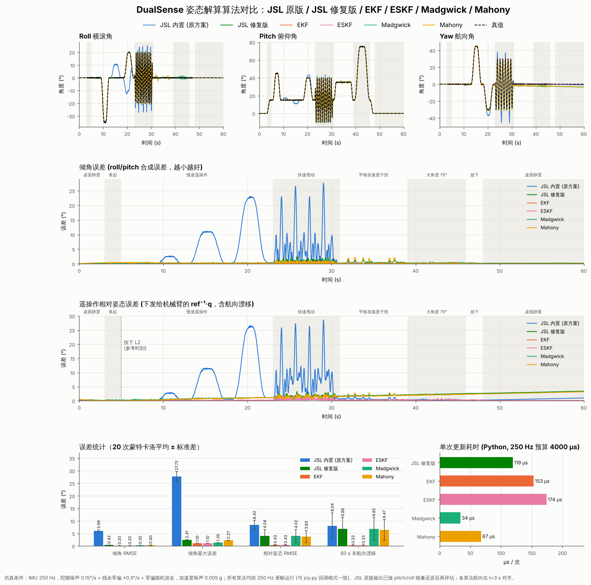
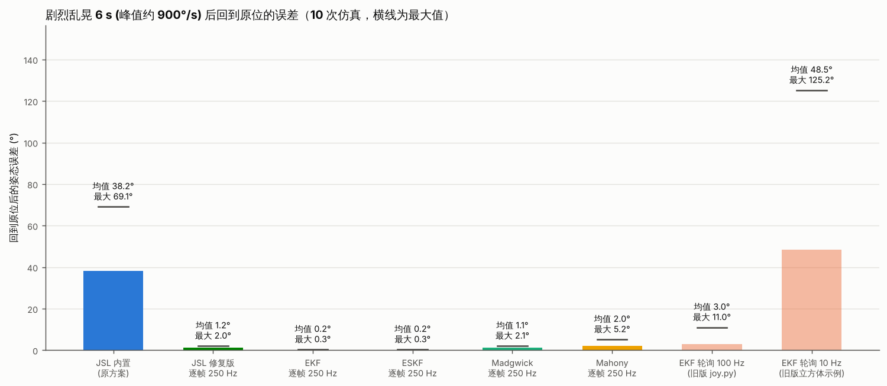

# DualSense Robot Teleop

基于 PS5 DualSense 手柄姿态数据的机械臂遥操作项目。

这个仓库当前的主程序是 `servo_control.py`：它读取手柄四元数、按键和摇杆输入，将其映射为机械臂末端位姿控制指令，并通过 Fairino 机械臂接口实时下发。

除了机械臂控制主程序，仓库里还保留了两个便于调试和演示的脚本：

| 脚本 | 作用 |
|---|---|
| `servo_control.py` | 主程序。使用 DualSense 控制机械臂姿态与平移 |
| `joy.py` | 直接读取手柄姿态，可在终端实时显示原始欧拉角 |
| `cube_3d_from_joy.py` | 使用 `vpython` 显示 3D 正方体，观察手柄姿态变化 |
| `ahrs_compare.py` | 各姿态解算算法的仿真对比 / 真实数据录制回放，生成对比图 |

## 功能概览

| 功能 | 说明 |
|---|---|
| 手柄姿态读取 | 通过 `JoyShockLibrary.dll` 读取 DualSense 陀螺仪 / 加速度计 |
| 姿态解算算法可选 | `--ahrs jsl / jsl_fixed / ekf / eskf / madgwick / mahony`，默认 EKF |
| 原始角度显示 | `joy.py` 可直接输出 Roll / Pitch / Yaw |
| 3D 姿态可视化 | `cube_3d_from_joy.py` 用 VPython 显示旋转正方体 |
| 机械臂遥操作 | `servo_control.py` 将手柄姿态映射为机械臂末端姿态 |
| 平移控制 | 左摇杆控制 XY，右摇杆控制 Z |
| 平滑控制 | 使用位置低通滤波和旋转 Slerp 滤波降低抖动 |
| 离合控制 | 按住 `L2` 才接管控制，松开后停止下发 |
| 参考系重标定 | 按 `L1` 将当前姿态设为新的参考基准 |

## 运行环境

| 项目 | 说明 |
|---|---|
| 操作系统 | Windows |
| 手柄 | PS5 DualSense |
| 依赖库 | `numpy`、`scipy`、`matplotlib` 等 |
| 本地动态库 | `JoyShockLibrary.dll` |
| 机械臂接口 | 仓库内 `fairino` 目录 |

## 安装依赖

先安装基础依赖：

```bash
pip install -r requirements.txt
```

如果你需要显示 3D 正方体，再额外安装：

```bash
pip install vpython
```

## 主程序：机械臂遥操作

运行主程序：

```bash
python servo_control.py
```

运行前请先检查 `servo_control.py` 中的机械臂 IP 配置，例如：

```python
IP = '192.168.58.2'
```

程序启动后会：

1. 连接机械臂并回到初始位姿
2. 连接 DualSense 手柄
3. 读取手柄姿态、L1/L2 和摇杆输入
4. 将手柄相对姿态映射到机械臂末端姿态
5. 以固定频率向机械臂发送控制命令

也可以在命令行选择姿态解算算法（不写默认用 `servo_control.py` 顶部的 `AHRS_ALGORITHM = "ekf"`）：

```bash
python servo_control.py --ahrs ekf        # 航姿扩展卡尔曼滤波 (推荐，默认)
python servo_control.py --ahrs madgwick   # Madgwick 梯度下降滤波
python servo_control.py --ahrs jsl        # JoyShockLibrary 内置融合 (原方案)
python servo_control.py --ahrs eskf       # 误差状态卡尔曼滤波
python servo_control.py --ahrs mahony     # Mahony 互补滤波
python servo_control.py --ahrs jsl_fixed  # JSL 同一算法的上游修复版
```

`joy.py` 和 `cube_3d_from_joy.py` 同样支持 `--ahrs` 参数。

### 按键与控制方式

| 输入 | 功能 |
|---|---|
| `L1` | 重新校准参考姿态 |
| `L2` | 按住时开始控制机械臂，松开停止发送 |
| 左摇杆 | 控制末端平移 XY |
| 右摇杆上下 | 控制末端平移 Z |

## 调试脚本 1：查看原始角度

如果你只是想确认手柄姿态数据是否正常，可以直接运行：

```bash
python joy.py
```

这个脚本会在终端持续输出手柄当前的原始欧拉角：

- `Roll`
- `Pitch`
- `Yaw`

适合用来做以下检查：

- 手柄是否成功连接
- 四元数转欧拉角是否正常
- 姿态方向和轴定义是否符合预期

## 调试脚本 2：显示 3D 正方体

如果你想更直观看手柄姿态变化，可以运行：

```bash
python cube_3d_from_joy.py
```

这个脚本会打开一个 VPython 窗口，显示一个会跟随手柄旋转的正方体，同时在界面中显示：

| 显示内容 | 说明 |
|---|---|
| Display Roll / Pitch / Yaw | 相对姿态显示角度 |
| Raw Roll / Pitch / Yaw | 手柄原始欧拉角 |
| L1 / L2 状态 | 当前按键与离合状态 |

这非常适合在接机械臂之前先验证：

- 姿态读取是否稳定
- 参考系是否符合你的预期
- `L1` / `L2` 的逻辑是否正确

## 姿态解算算法

算法实现在 `ahrs.py`，由 `joy.py` 的 `JoyShockDevice(ahrs=...)` 统一调用。

| 参数 | 算法 | 说明 |
|---|---|---|
| `jsl` | JoyShockLibrary 内置融合 | 原方案，直接读取 DLL 输出的四元数 |
| `jsl_fixed` | JSL 内置融合 (上游修复版) | 同一算法的 Python 移植，套用上游 GamepadMotionHelpers 对重力修正的三行修复 |
| `ekf` | 航姿扩展卡尔曼滤波 (EKF-AHRS) | 7 维状态 = 四元数 + 三轴陀螺零偏，加性更新，参考 [waihekor/EKF_AHRS](https://github.com/waihekor/EKF_AHRS) 与 [Agilex Piper 手机遥操作](https://github.com/agilexrobotics/Agilex-College/blob/master/piper/mobilePhoneCtl/main.py) |
| `eskf` | 误差状态卡尔曼滤波 (ESKF / MEKF) | 6 维误差状态 = 姿态误差角 + 零偏误差，乘性注入，参考 J. Solà《Quaternion kinematics for the error-state Kalman filter》；噪声、门限、ZARU 与 `ekf` 完全相同 |
| `madgwick` | Madgwick 梯度下降滤波 | 主流轻量 AHRS，单参数 β 调节 (β = 0.05) |
| `mahony` | Mahony 显式互补滤波 | PI 修正，积分项估计零偏 (Kp = 0.5, Ki = 0.02，在独立的仿真种子上扫参选出) |

EKF 相对参考代码的改进：

1. 状态转移雅可比加入了 "四元数-零偏" 耦合项（参考代码中 `A_12 = 0`），零偏收敛更快；
2. 过程噪声由陀螺噪声推导并随 `dt` 缩放，读取频率变化时不用重新调参；
3. 加速度观测噪声随 `| |a| - 1g |`、晃动度 (加速度相对平滑值的波动) 和角速度自适应放大，剧烈晃动时跳过重力修正、只靠陀螺积分，手快速推拉或乱晃时姿态不会被拽歪；
4. 静止检测 + 零角速度修正 (ZARU)：手柄放在桌上时直接观测三轴零偏，DualSense 没有磁力计，这是抑制航向漂移的关键；
5. Joseph 形式协方差更新，数值更稳定。

除 `jsl` 外的算法都通过 `JslSetCallback` 在 DLL 的输入线程里**逐帧 (约 250 Hz) 积分**，步长用手柄上报的帧间隔，
和主循环的读取频率无关（立方体示例只有 10 Hz 刷新也不受影响）。DLL 不支持回调时才退回到 `JslGetAndFlushAccumulatedGyro` 轮询。

### 关于 JSL 内置四元数的 pitch/roll 方向

JoyShockLibrary 打包的旧版 GamepadMotionHelpers 在重力修正里把四元数的方向用反了，导致输出的 pitch/roll 是镜像的
（上游已在 [GamepadMotionHelpers@a061205](https://github.com/JibbSmart/GamepadMotionHelpers/commit/a061205) "Fix GetOrientation() returning inverted pitch/roll" 修复，但 JoyShockLibrary 没有同步）。
`servo_control.py` 中的 `R_map` 是基于这个输出标定的，所以其余算法输出时都会转换成相同约定
（四元数 `(w, x, y, z) -> (w, -x, y, -z)`，见 `ahrs.jsl_convention`），**切换算法后机械臂的运动方向不变，`R_map` 无需修改**。
这个 bug 还会让手柄在有俯仰角时做横滚/航向动作出现轴间耦合，这是下面对比中 JSL 误差偏大的主要原因。

### 算法对比

```bash
python ahrs_compare.py              # 20 次蒙特卡洛仿真，生成 docs/ahrs_comparison.png 和 docs/ahrs_shake_test.png
python ahrs_compare.py --record 30  # 用真实手柄录 30 秒数据到 imu_record.csv (Windows)
python ahrs_compare.py --csv imu_record.csv   # 回放真实数据，生成 docs/ahrs_replay.png
```

仿真轨迹包含桌面静置、慢速遥操作、快速甩动 (~200°/s)、平移加速度干扰 (~0.6 g)、75° 大角度、放下静置等阶段；
IMU 250 Hz，陀螺噪声 0.15°/s + 残余零偏 ±0.3°/s + 零偏随机游走，加速度噪声 0.005 g。



20 次蒙特卡洛结果（单位：度，均值 ± 标准差）：

| 指标 | JSL 原版 | JSL 修复版 | EKF | ESKF | Madgwick | Mahony |
|---|---|---|---|---|---|---|
| 倾角 RMSE | 5.99 ± 0.52 | 0.42 ± 0.04 | **0.20 ± 0.00** | **0.20 ± 0.00** | 0.30 ± 0.01 | 0.40 ± 0.04 |
| 倾角最大误差 | 27.72 ± 1.99 | 2.41 ± 0.21 | **1.10 ± 0.03** | **1.10 ± 0.03** | 1.35 ± 0.09 | 2.27 ± 0.07 |
| 遥操作相对姿态 RMSE | 8.42 ± 1.84 | 4.04 ± 2.59 | **0.43 ± 0.15** | **0.43 ± 0.15** | 4.02 ± 2.61 | 3.83 ± 2.41 |
| 遥操作相对姿态最大误差 | 28.89 ± 1.49 | 7.14 ± 4.17 | **1.62 ± 0.18** | **1.62 ± 0.18** | 7.00 ± 4.33 | 6.68 ± 3.87 |
| 60 s 末航向漂移 | 8.04 ± 5.24 | 6.86 ± 4.49 | **0.33 ± 0.21** | **0.33 ± 0.21** | 6.85 ± 4.51 | 6.47 ± 4.11 |
| 单次更新耗时 (Python) | DLL 内计算 | 约 120 µs | 约 150 µs | 约 175 µs | 约 34 µs | 约 67 µs |

结论：

- **EKF 与 ESKF 结果一致且最好**。两者共用同一套噪声模型、晃动门限和静止零偏修正，误差小时两种线性化几乎等价；
  差别主要在鲁棒性：把初始姿态方差放大到约 11° 时 ESKF 的相对姿态 RMSE 会恶化到约 3°，EKF 只到约 0.7°
  (原因见 `ahrs.py` 中 `_GravityAidedKalman` 的说明)，去掉晃动门限时 ESKF 在乱晃测试中的误差会超过 60°。
- **JSL 修复版 / Madgwick / Mahony 倾角精度接近**，但都没有静止零偏修正，航向随残余零偏线性漂移 (60 s 约 6~7°)；
  Mahony 的积分项只能估计水平两轴零偏，航向零偏不可观。
- **JSL 原版** 的误差主要来自 pitch/roll bug 造成的轴间耦合，修复后倾角 RMSE 从约 6° 降到 0.4°。
- 250 Hz 逐帧运行时，最慢的 ESKF 约占一个 CPU 核的 4.4%。

仿真结论仍需在真机上确认，可用 `--record` / `--csv` 录制回放真实数据对比。

### 剧烈乱晃后回到原位

手持抬头 15°，三轴剧烈乱晃 6 s（峰值约 900°/s，平移加速度约 0.8 g）后放回原位，比较姿态误差：



| 方式 | 回到原位误差 均值 / 最大 |
|---|---|
| JSL 内置 (原方案) | 38.2° / 69.1° |
| JSL 修复版 逐帧 250 Hz | 1.2° / 2.0° |
| **EKF 逐帧 250 Hz (当前)** | **0.2° / 0.4°** |
| **ESKF 逐帧 250 Hz** | **0.2° / 0.4°** |
| Madgwick 逐帧 250 Hz | 1.1° / 2.1° |
| Mahony 逐帧 250 Hz | 2.0° / 5.2° |
| EKF 轮询 100 Hz (旧版 joy.py) | 3.0° / 11.0° |
| EKF 轮询 10 Hz (旧版立方体示例) | 48.5° / 125.2° |

- 轮询时每次只拿到一段时间的平均角速度，剧烈晃动下三轴转动不可交换、每次拿到的帧数也不固定，
  误差会累积；立方体示例只有 10 Hz 刷新，误差最大。现在改为逐帧回调积分后，刷新频率不再影响精度。
- JSL 内置融合在剧烈晃动时，上面提到的 pitch/roll bug 会让重力修正和陀螺积分互相打架，误差漏到航向里；
  套用上游修复后降到 1.2°。
- Mahony 的积分项在乱晃时会积累错误的零偏，Ki 越大越明显 (Ki = 0.1 时约 8°)，所以默认取较小的 Ki。
- DualSense 没有磁力计，航向 (yaw) 没有绝对参考，乱晃后残留的小幅航向偏差无法自动修正，属于物理限制，
  可以按 `L1` 重新对齐；pitch/roll 有重力参考，静止 1~2 秒内会自动收敛回来。
- 陀螺量程为 ±2000°/s，甩得比这更快会饱和，饱和期间丢失的角度任何算法都无法恢复。

## 项目结构

| 路径 | 说明 |
|---|---|
| `servo_control.py` | 机械臂遥操作主程序 |
| `joy.py` | JoyShockLibrary 轻量封装与原始角度读取 |
| `cube_3d_from_joy.py` | 基于 `joy.py` 的 VPython 可视化脚本 |
| `ahrs.py` | 姿态解算算法：EKF、ESKF、Madgwick、Mahony、JSL 内置融合的 Python 移植 (原版 / 修复版) |
| `ahrs_compare.py` | 算法对比仿真、真实数据录制与回放 |
| `docs/ahrs_comparison.png` | 算法对比图 |
| `docs/ahrs_shake_test.png` | 剧烈乱晃后回到原位测试图 |
| `JoyShockLibrary.dll` | 手柄底层动态库 |
| `fairino/` | 机械臂 Python 接口 |
| `requirements.txt` | Python 依赖列表 |

## 注意事项

| 项目 | 说明 |
|---|---|
| 校准 | 启动手柄后尽量保持平稳几秒，等待底层完成校准 |
| 网络 | 机械臂控制前请确认本机与机械臂 IP 可连通 |
| 安全 | 首次运行 `servo_control.py` 时建议低速、空载、留足安全空间，推荐先在法奥的仿真环境中测试 |
| 依赖 | 若 `cube_3d_from_joy.py` 无法运行，通常是未安装 `vpython` |
| 中断 | 按 `Ctrl+C` 可安全退出脚本 |


